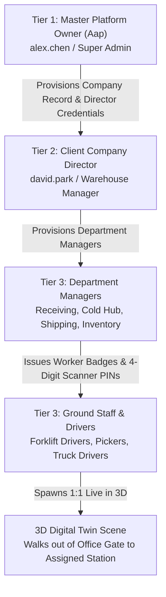

# WareTrack 3D: Enterprise Platform Complete Operational Manual & Workflow Guide

---

## 1. Executive Summary & Business Architecture

**WareTrack 3D** is a **Warehousing-as-a-Service (WaaS) & 3PL Multi-Tenant SaaS Platform**.
You own the platform and operate two physical warehouse facilities:
1. **WareTrack Central Hub (WH-01):** High-bay ambient storage with 4 roll-up loading bays, automated pallet racks, bulk outdoor yard, and management offices.
2. **Riverside Hub (WH-02):** Cold-chain deep freezer and chiller facility (-20°C pharma and frozen food storage) with 3 refrigerated dock portals and IoT telemetry.

Client companies (such as pharmaceutical distributors, supermarket food chains, electronics brands, and auto manufacturers) subscribe to store their inventory in your facilities. They access their own dedicated sub-portal to manage inventory, track shipments, supervise their dedicated workforce, and monitor monthly rental billing meters.

---

## 2. Platform Persona & 3-Tier ID/Password Delegation Workflow

There is **no public registration or self-signup**. Access is strictly hierarchical and provisioned top-down.

### Tier 1: Master Platform Owner (Aap)
* **Who:** Super Administrator (`Alex Chen`).
* **Capabilities:** Full system authority. You provision client companies, allocate warehouse bays, monitor overall storage revenue across all clients, configure IoT sensor thresholds, and inspect global fleet movements.
* **How to Use:**
  1. Navigate to **Users & Roles** (`#/users`).
  2. Open the **Client Companies & Subscriptions** tab.
  3. Click **[Provision Client Company & Director]**.
  4. Fill in Company Name, Storage Plan, Director Name, Director Email, and Initial Password.
  5. The platform generates a **Client Handover Packet**. Click **[Copy Credentials Packet]** and send it directly to the client director via email or message.

### Tier 2: Client Company Director
* **Who:** Company Executive / Site Director (e.g., `David Park` for Apex Pharma Logistics).
* **Capabilities:** Sees only their company's stock, orders, deliveries, and storage bill. Cannot see rival companies' data.
* **How to Use:**
  1. Director logs in with the credentials provided by you.
  2. Under `#/users`, clicks **[+ Dept Manager]** on their company card.
  3. Creates managers for Receiving, Cold Storage, Shipping, or Inventory.
  4. Hands over the generated manager credentials.

### Tier 3: Department Managers & Ground Staff
* **Who:** Operations Leads (e.g., `Priya Nair` - Receiving Lead, `Elena Petrova` - Inventory Lead, `Aisha Khan` - Cold Hub Lead).
* **Capabilities:** Assign picking/putaway tasks, run barcode inventory audits, and issue Ground Worker Badges.
* **How to Use:**
  1. Manager clicks **[+ Issue Worker Badge]**.
  2. Enters Worker Name, Department, Job Title, and 4-Digit Terminal PIN.
  3. **Instant 3D Reflection:** As soon as the badge is issued, the new worker avatar spawns at the Management Office door (`x=22, z=11.7`) in 3D, dressed in their department uniform, and walks to their workstation.

---

## 3. End-to-End Operational Workflows

### Workflow A: Inbound Receiving & Barcode Scanning
1. **Shipment Arrival:** A supplier truck arrives at an inbound loading bay (e.g., Dock 1).
2. **Dock Detection & Forklift Trigger:**
   * The intelligent dock sensor detects the parked truck.
   * A steel leveler ramp extends between the warehouse floor and the truck bed.
   * Forklift drives orthogonally from the indoor staging pad through the open gate, enters the truck bed, lifts pallets, and transfers them into the warehouse staging bay.
3. **Barcode Scanning:**
   * Open **Inventory** (`#/inventory`) and click **[Scan Barcode]**.
   * Choose from 3 input methods:
     * **Laser / USB Barcode Gun:** Plug and play. Scans barcodes instantly into the buffer.
     * **Device Camera Stream:** Uses web camera to read QR/Code-128 tags live.
     * **Manual Fallback:** Type or paste SKU/Batch number directly.
4. **Barcode Label Printing:**
   * Click **[Print Label]** on any inventory item.
   * Generates a printable Code-128 sticker sheet complete with SKU, Name, Lot Number, and Storage Location.
5. **Putaway Task:**
   * The system automatically generates a putaway task.
   * A receiving worker picks up the pallet and carries it to the assigned rack slot.

---

### Workflow B: Smart 3D Pick-Path Optimization & Order Fulfillment
1. **Order Creation:** An order is created or received from client stores via API or UI (`#/orders`).
2. **Picking Assignment:**
   * The order moves to `Processing`.
   * A picker worker is assigned to collect goods from racks.
3. **Smart 3D Pick-Path Visualization:**
   * Click on any rack or pallet in the 3D scene.
   * An animated **glowing green dashed ribbon** illuminates on the warehouse floor.
   * It calculates and displays the shortest collision-free pedestrian walking route from dock staging through the aisles directly to the rack approach point.
   * Glowing circular waypoints indicate corner turns along the route.
4. **Packing & Dispatch:**
   * The worker picks the goods and delivers them to the packing station.
   * The order updates to `Packed` and then `Ready for Dispatch`.

---

### Workflow C: Outbound Delivery, Fleet Physics & Public Tracking Link
1. **Dock Loading:**
   * An outbound delivery truck (e.g., `TRK-102` or `REF-401`) backs up to an outbound dock door (e.g., Dock 3 or Dock 4).
   * Dock indicator beacon switches from green (`free`) to amber (`occupied`).
   * The dock forklift activates, picks up the packed pallets from staging, moves through the gate portal into the truck bed, and loads the cargo.
2. **Departure onto Highway:**
   * The truck departs the dock, drives down the one-way outbound yard road, and enters the public transit lane.
3. **Shareable Live Tracking Link:**
   * Open **Deliveries** (`#/deliveries`) and click **[Live Tracking Link]**.
   * A public tracking modal opens with a shareable URL (`http://127.0.0.1:3000/#/track/<CODE>`).
   * The client or customer opens the link to see:
     * Live transit status and destination ETA.
     * Assigned driver details and vehicle registration.
     * Complete manifest of packed cargo items.
     * **Digital Signature Pad:** Upon delivery arrival, the customer signs their digital signature directly on the canvas screen as Proof of Delivery (POD).

---

### Workflow D: WaaS Storage Billing & IoT Cold-Chain Compliance
1. **Automated Pallet Rental Billing:**
   * Located directly on the **Dashboard** (`#/`).
   * Real-time calculation based on actual stored pallets:
     $$\text{Daily Bill} = (\text{Ambient Pallets} \times \$1.50) + (\text{Cold Pallets} \times \$3.50) + (\text{Truck Handling Loads} \times \$10.00)$$
   * Displays the current month accrued invoice in USD (e.g., `$5,630 / month`).
   * Clients can click **[Download Storage Invoice PDF]** for accounting reconciliation.
2. **IoT Cold-Chain Compliance Monitor:**
   * Dedicated live telemetry card on Dashboard for Riverside Hub WH-02.
   * Real-time sensor readings:
     * Chiller Zone A (Pharma): Target `-20°C` | Actual `-20.4°C` (Optimal).
     * Chiller Zone B (Frozen Foods): Target `-18°C` | Actual `-19.6°C` (Optimal).
   * Critical red alert triggers if temperature rises above `-15°C`.
   * Clients can download the official **Temperature Compliance Certificate** required for government health inspections.

---

### Workflow E: 1-Click CSV Bulk Inventory Import & Export
1. **Bulk Onboarding:**
   * When a client company joins with hundreds of products, they do not need to manually enter each item.
   * Open **Inventory** (`#/inventory`) and click **[Bulk CSV Upload]**.
   * Select a `.csv` file containing SKU, Name, Category, Price, and Initial Quantity.
   * The system parses and registers all items instantly.
2. **Inventory Audit Export:**
   * Click **[Export CSV]** at any time to export the current on-hand stock, batch lots, and rack locations into a clean spreadsheet file.

---

## 4. 3D Digital Twin Navigation & Simulation Controls

| Control | Action |
| :--- | :--- |
| **Left Click + Drag** | Orbit and rotate the 3D warehouse camera |
| **Right Click + Drag** | Pan across the warehouse floor and yard |
| **Scroll Wheel** | Zoom in / Zoom out |
| **Click on Rack / Pallet** | Selects rack, reveals contents, and draws green Pick-Path |
| **Click on Worker** | Displays worker profile, current task, and department |
| **Click on Vehicle / Truck** | Displays vehicle status, driver, and cargo manifest |
| **Roof Lift Toggle** | Lifts the warehouse roof to reveal interior aisles and staging |
| **Reset View** | Snaps camera back to default isometric overview |

### Autonomous Auto-Pilot Simulator
* Located at the top-right header: **`[Auto-Pilot: ON / OFF]`**.
* **When ON:** The system runs autonomous background operations (simulates inbound supplier arrivals, schedules outbound orders, dispatches trucks, and tasks workers). Ideal for demos and client pitches. Speed can be adjusted to `[1x | 2x | 5x]`.
* **When OFF:** All autonomous actions freeze. The platform gives you 100% manual control over every single task, movement, and stock update.

### Topbar One-Click Persona Switcher
* Located at the top-right header next to Auto-Pilot.
* Instantly switch between operational roles without logging out:
  * **Alex Chen:** Super Administrator / Master Platform Owner.
  * **David Park:** Client Site Director (Riverside Hub).
  * **Priya Nair:** Receiving Lead.
  * **Elena Petrova:** Inventory Controller.
  * **Aisha Khan:** Ground Worker / Loader.
