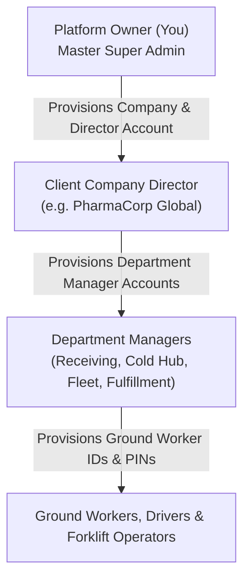
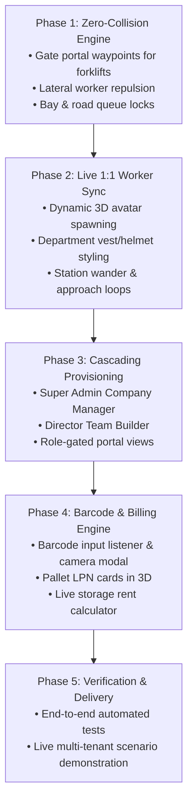

# WareTrack 3D Enterprise SaaS: Master Architecture & Execution Plan

---

## Executive Summary

WareTrack 3D is engineered as a commercial **Warehousing-as-a-Service (WaaS) & 3PL Multi-Tenant Platform**. The platform owner owns and operates the master infrastructure, licensing dedicated storage capacity, cold chain facilities, and logistics capabilities to client companies under a secure, contract-provisioned B2B model.

This master plan guarantees:
1. **Zero-Collision 3D Navigation:** Workers, trucks, and forklifts operate with strict mathematical boundary boxes, lane queues, and dynamic clearance vectors. Forklifts enter/exit through dock doors orthogonally with zero wall clipping.
2. **1:1 Live Worker Reflection:** Every employee ID created by a company manager instantly manifests in the 3D digital twin as an animated worker walking out of the office to their station.
3. **Cascading Enterprise Provisioning:** No open registration. Credentials flow securely: Owner $\rightarrow$ Company Director $\rightarrow$ Department Managers $\rightarrow$ Ground Operators.
4. **Industrial Inventory Tracking:** Integrated barcode scanning (Laser Gun, Mobile Camera, and Manual Fallback), Batch/Lot tracking, and printable barcode labels.
5. **Automated Pallet Storage Billing:** Real-time rental meter calculating ambient vs. cold-chain pallet storage fees.

---

## 1. Zero-Collision 3D Navigation & Door-Portal Pathing

### A. Forklift Loading Pathing (Gate-Portal Waypoint System)
To guarantee the package-loading forklift never passes through building walls or workers, movements are constrained to an **Orthogonal Gate Portal Graph**:

```
[Indoor Staging Bay] ──(z: 4.0)──► [Roll-up Dock Portal] ──(z: 10.0)──► [Dock Leveler Ramp] ──(z: 12.5)──► [Truck Cargo Bed] ──(z: 15.5)
```

- **Collision Rules:**
  - **Dock Lock:** A dock door only opens when a truck is docked and in `loading` or `unloading` status.
  - **Straight-line Axis:** Forklifts enter and exit perpendicular to the wall ($\Delta x = 0$) within the dock door aperture ($x \pm 2.0\text{m}$). Diagonal transit through wall polygons is mathematically blocked.
  - **Elevated Height Offset:** Pallet lifting tines articulate on the vertical mast between ground level ($y = 0.25\text{m}$) and rack shelf height ($y = 1.6\text{m} - 4.2\text{m}$), preventing pallets from intersecting structural beams.

### B. Worker-on-Worker Anti-Collision (Separation Radius)
- **Separation Vector:** When two workers traverse the same aisle or walkway, a dynamic lateral offset ($[-0.6\text{m}, +0.6\text{m}]$ perpendicular to travel direction) ensures they walk on opposite sides of the centerline.
- **Queueing at Stations:** Racks and dock stations feature a multi-slot queue; if Worker A is actively picking at Rack B-1-2, Worker B waits at the aisle approach node until the slot clears.

### C. Vehicle Lane Queuing & Bay Exclusivity
- **Dock & Bay Mutex:** Parking bays 0 through 7 and Docks 1 through 7 use unique mutual-exclusion state locks. No two vehicles are ever routed to the same bay or dock.
- **Following Distance:** On the one-way transit road ($z = 34.5$ and $z = 39.5$), vehicles maintain a minimum 14-meter longitudinal buffer.

---

## 2. 1:1 Live 3D Worker Lifecycle (Sync Engine)

Every employee in the database has a persistent, 1:1 animated avatar in the 3D scene:


- **Visual Identification by Department:**
  - **Inbound & Receiving:** Safety Orange hard hat & vest (`#f97316`)
  - **Cold Storage & Quality:** Arctic Cyan hard hat & thermal parka (`#0ea5e9`)
  - **Fulfillment & Picking:** High-visibility Yellow hard hat (`#facc15`)
  - **Shipping & Fleet:** Royal Blue jacket (`#3b82f6`)
  - **Management & Compliance:** Navy suit with security badge (`#1e3a8a`)
- **Status Behaviors:**
  - `available`: Wanders within designated department perimeter or stands at workstation.
  - `busy`: Actively moves to target rack or dock door to perform task.
  - `on_break`: Walks to central outdoor break lounge.
  - `off_duty`: Walks inside Management Office and transitions to invisible.

---

## 3. Multi-Tenant Enterprise RBAC & Cascading Credentials

No public signup. Credential provisioning flows hierarchically:



### Permission Matrix

| Role | Scope | Capabilities |
| :--- | :--- | :--- |
| **Platform Master (You)** | All Facilities & Companies | Onboard companies, allocate warehouse square footage/racks, view platform-wide billing, manage physical infrastructure. |
| **Company Director** | Own Company Tenant | Create departments, assign department heads, view company inventory valuation, view monthly storage invoice. |
| **Department Manager** | Own Department Team | Schedule shifts, assign tasks to workers, approve receiving/dispatch slips, monitor department productivity. |
| **Ground Operator / Driver** | Assigned Tasks | View personal work queue, scan barcodes, mark tasks in-progress and complete. |

---

## 4. Barcode Scanning, LPN & Pallet Data Engine

```
[Physical Box / Pallet] ──► [Laser Gun / Camera Scan] ──► [Fast Input Listener] ──► [Instant Product & Rack Modal]
```

1. **Barcode Input Listener:**
   - Supports plug-and-play USB/Bluetooth barcode guns (detects rapid input buffer $< 50\text{ms}$ ending in `Enter`).
   - Integrated mobile/laptop camera scanner using WebRTC video feed.
   - Manual search fallback for damaged barcodes.
2. **Pallet License Plate Number (LPN):**
   - Pallets carry unique master tracking IDs (e.g. `LPN-8042-WH02`). Scanning the LPN immediately displays all contained item batches, quantities, and inspection stamps.
3. **Printable Barcode Labels:**
   - 1-click generation of Code-128 and QR-code printable sticker sheets (formatted for standard thermal label printers).

---

## 5. Automated Pallet Storage Billing & Rent Calculator

Provides transparent, automatic monetization for the platform owner:

$$\text{Monthly Invoice} = \sum (\text{Ambient Pallets} \times \$1.50 \times \text{Days}) + \sum (\text{Cold Pallets} \times \$3.50 \times \text{Days}) + (\text{Dock Handlings} \times \$10.00)$$

- **Live Rent Meter:** Client companies see their daily accrued storage costs in real-time.
- **Platform Owner Revenue Dashboard:** Aggregates MRR (Monthly Recurring Revenue) across all active client tenants.

---

## 6. Implementation Roadmap


