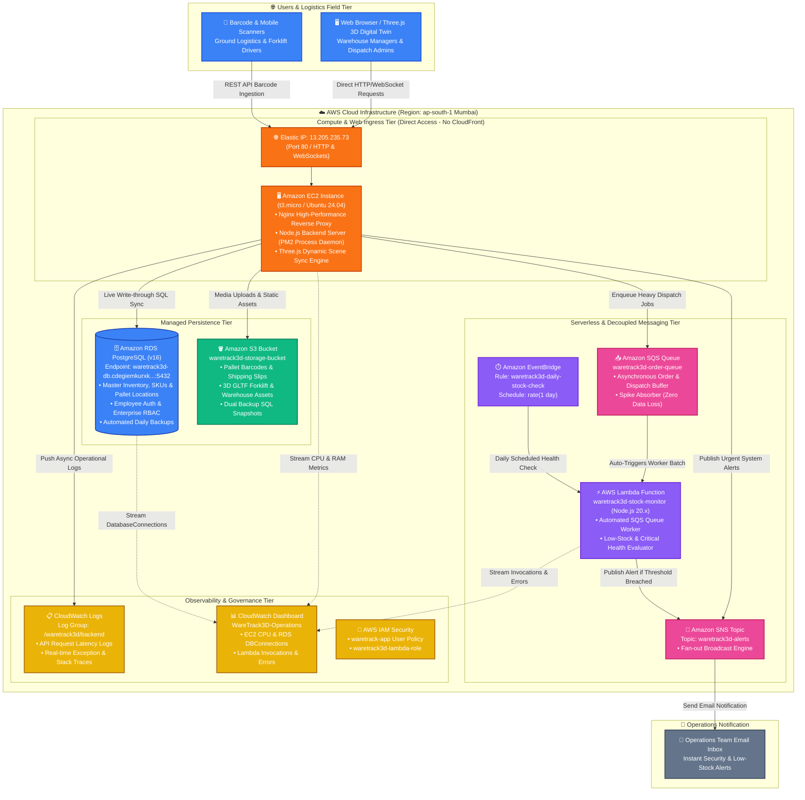

# WareTrack3D: Production AWS Cloud Architecture Blueprint (Zero-CloudFront)

---

## 1. Official Architecture Diagram (Without CloudFront)

This architecture reflects the **live, verified AWS deployment** in `ap-south-1` (Mumbai). All traffic routes directly to the Nginx reverse proxy on the EC2 Elastic IP, bypassing CloudFront edge distribution for maximum 3D rendering speed and real-time SSE stream stability.

---

## 2. Key Architecture Principles (Why CloudFront Was Omitted)

1. **Direct Elastic IP + Nginx Ingress:**
   - Instead of routing through CloudFront CDN edge distributions, WareTrack3D utilizes a dedicated AWS Elastic IP (`13.205.235.73`) attached to EC2.
   - **Advantage:** Preserves low-latency Server-Sent Events (SSE) and persistent WebSockets for live 3D worker avatar positioning without CDN timeout interruptions or edge caching issues.
2. **Decoupled Asynchronous Processing (SQS $\rightarrow$ Lambda):**
   - High-throughput warehouse actions (such as dock door arrivals and barcode batch scans) are immediately acknowledged by EC2 and placed on **Amazon SQS**.
   - **AWS Lambda** automatically polls the queue, executes business logic without consuming EC2 CPU, and scales to zero when idle.
3. **Dual Resilience & Failover:**
   - Fast local cache guarantees the Three.js viewport maintains 60 FPS even under heavy load.
   - Master data safely commits to **Amazon RDS PostgreSQL** with automated point-in-time recovery.
4. **Autonomous Serverless Heartbeat (EventBridge $\rightarrow$ Lambda $\rightarrow$ SNS):**
   - Independent of the EC2 instance status, Amazon EventBridge triggers Lambda daily to inspect inventory thresholds and dispatch critical email alerts via Amazon SNS.

---

## 3. Active AWS Resource Inventory

| Service | Resource Name / ID | Configuration Details |
|---|---|---|
| **EC2** | `i-0f9e9ec58e65ea749` | Ubuntu 24.04 LTS, Elastic IP: `13.205.235.73`, Port 80 (Nginx) $\rightarrow$ Port 3000 (Node.js) |
| **RDS** | `waretrack3d-db` | PostgreSQL 16.x, `ap-south-1`, Storage: 20 GB gp3, Auto-minor upgrade enabled |
| **S3** | `waretrack3d-storage-bucket` | Standard storage tier, `ap-south-1`, Block Public Access configured with IAM access |
| **SQS** | `waretrack3d-order-queue` | Standard Queue, Default 30s visibility timeout, 4-day retention, Lambda trigger attached |
| **Lambda**| `waretrack3d-stock-monitor` | Node.js 20.x, x86_64, Role with `AWSLambdaSQSQueueExecutionRole` & `AmazonSNSFullAccess` |
| **EventBridge**| `waretrack3d-daily-stock-check` | Cron schedule: `rate(1 day)` targeting `waretrack3d-stock-monitor` |
| **SNS** | `waretrack3d-alerts` | Standard topic, email endpoint subscription active |
| **CloudWatch**| `/waretrack3d/backend` | Batched asynchronous JSON structured logging, Metrics dashboard for EC2/RDS/Lambda |

---

## 4. How to Present This Architecture in Viva / Interview

When explaining this architecture, walk the examiner through the **3-Tier Flow**:

1. **Tier 1 (Compute & Ingress):**
   > *"Users and ground barcode scanners connect directly to our EC2 instance via an Elastic IP running an Nginx reverse proxy. We intentionally avoided CloudFront to keep WebSocket/SSE streams direct and real-time for our Three.js 60 FPS 3D digital twin."*
2. **Tier 2 (Decoupled Processing):**
   > *"To prevent server bottlenecks during peak loading hours, our backend offloads dispatch tasks into Amazon SQS. AWS Lambda automatically triggers on incoming SQS messages, acting as a serverless queue worker."*
3. **Tier 3 (Persistence & Observability):**
   > *"Master data is committed to Amazon RDS PostgreSQL, static labels and backups are preserved on Amazon S3, and health alerts are published via Amazon SNS. Everything is monitored live in CloudWatch."*
